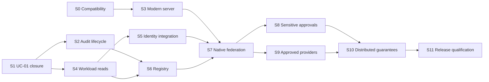

# Gateway gaps and implementation sprint roadmap

Date: 2026-10-28. Reviewed runtime baseline: `1e9c6a7`.
Status: S0 investigation complete with a migration blocker; S1-S11 remain pending.
This plan refines the [enterprise vision](ENTERPRISE_MCP_VISION.md) and the
[October 18 review](GATEWAY_REVIEW_AND_NEXT_FEATURES.md). Existing requirements,
foundation guarantees and acceptance states retain their authority.

## Recommendation and meaning of complete

S0 compatibility investigation is complete; read the
[executed findings](S0_COMPATIBILITY_FINDINGS.md) and
[normative requirement inventory](MCP_2026_REQUIREMENTS.md). Retain pinned
dependencies because modern client, Spring binding and header handling remain
blocked. Next is **S1: supported UC-01 lifecycle and queued-revocation closure**.
Develop the audit lifecycle
contract before implementing physical retention. Add the modern protocol through
compatible SDKs, then workloads, interoperable identity integration, registry,
native federation, approvals, approved providers and distributed operation.

The current product is a tested local MCP-to-REST gateway with an opt-in
enterprise delegated-read slice. It is not yet the complete federated platform
described in the vision. Completion has three separate gates:

| Gate | Required result | Current position |
| --- | --- | --- |
| Protocol and interoperability | All applicable MUSTs for explicitly supported revisions and advertised capabilities; tested inbound server and outbound client behavior | `2025-11-25` foundation evidence exists; modern revision and native federation are pending |
| Enterprise functional baseline | Identity v1.4 MUSTs and IA-AC-01 through IA-AC-32, plus catalog v1.3 obligations, with requirement-to-test evidence | Partial/pending; positive workloads, sensitive approvals and approved providers are missing |
| Operational release | A specified deployment topology with demonstrated durability, recovery, bounded revocation, isolation under saturation, and agreed service objectives | Local single-writer evidence exists; production topology and capacity are unproven |

A restricted internal read-only pilot can have its own documented gate. It must
be labeled with its limitations and cannot be presented as the full first release.
Optional protocol features are separately advertised and tested; completeness
does not require enabling every optional extension.

## Protocol target and dependency constraint

MCP uses dated protocol revisions. The official current revision is
`2026-07-28`; JSON-RPC `2.0`, Java SDK `2.0.0`, Spring AI `2.0.1` and the gateway
application version are separate identifiers. Use **MCP 2026-07-28** when
describing the proposed modern target. The repository currently tests
`2025-11-25`. See [official versioning](https://modelcontextprotocol.io/docs/2026-07-28/learn/versioning).

Do not choose an upgrade from a version number or roadmap alone. The SDK's older
[roadmap](https://raw.githubusercontent.com/modelcontextprotocol/java-sdk/main/ROADMAP.md)
assigns modern support to 3.x, but the newer
[2.2.0-M1 release](https://github.com/modelcontextprotocol/java-sdk/releases/tag/v2.2.0-M1)
already introduces a separate modern server. Its notes explicitly exclude a
modern client, Tasks and SEP-2243 custom headers, and describe a Reactor milestone
upgrade. S0 found that the published POM and Boot experiment instead resolve
Reactor Core 3.8.7. The findings distinguish these sources and executed results.

The [2.1.0 release](https://github.com/modelcontextprotocol/java-sdk/releases/tag/v2.1.0)
also introduces tool filtering and HTTP-client changes. This may reduce custom
session integration, but source inspection and BOM/starter verification are
required. A newer server API alone does not establish a usable modern federation
client. [ADR 0014](decisions/0014-modern-protocol-compatibility-proposal.md)
records the accepted keep-pinned-runtime decision without selecting modern
product dependencies. Experimental server success does not establish S3/S7 readiness.

Modern compatibility affects lifecycle, discovery, result types and transport,
not just an HTTP property. Use the separate
[protocol acceptance plan](MCP_PROTOCOL_ACCEPTANCE.md) and the
[official revision changes](https://modelcontextprotocol.io/specification/2026-07-28/changelog)
to create a complete applicable-requirement inventory during S0. Modern
authorization remains per request; caller-specific discovery remains valid.

## Reviewed baseline and gap register

Fresh verification on October 28 passed **143 unit/startup and 38 integration
tests**, with zero failures/errors/skips in 2:03. Command:

```powershell
.\mvnw.cmd -B -ntp '-Dgateway.build-directory=target/roadmap-review-20261028' verify
```

Log: `target/roadmap-review-20261028.log`; reports/JAR:
`target/roadmap-review-20261028`. These are independent mocks and running Boot/SDK
checks. They establish the current local boundary, not modern conformance, live
identity integration, hosted CI success or production capacity.

Priority P0 means a prerequisite for the capability or release it protects;
P1 means required operations or governance work. A pending feature is not itself
a demonstrated vulnerability. Prior review's rejection-audit, bounded-queue and
pagination fixes are already implemented and should not be scheduled again.

| Gap | Current evidence or code boundary | Remaining guarantee | Priority / sprint |
| --- | --- | --- | --- |
| G01: Modern protocol | `FilteredMcpTransport` decorates SDK sessions; clients initialize using the pinned SDK | Verified modern lifecycle and SDK integration; explicit legacy compatibility; both client/server support inventory | P0 / S0, S3, S7 |
| G02: UC-01 lifecycle | Current organization/tenant checks and bounded human/app administration | Authorized organization/tenant lifecycle, selective multi-tenant membership changes, stable authority/subject identity evidence and policy-default administration | P0 / S1 |
| G03: Revocation composition | Separate SDK revocation and bounded-queue tests | Real protocol calls queued under saturation, administrative revocation ordering, expiry and fresh admission; repeat for each added mode and replica | P0 / S1, S4, S8-S10 |
| G04: Audit lifecycle | Forced admission audit, digest-linked retained segments, scoped stable pages and 90-day visibility | Archive/checkpoint/restore contract, controlled physical expiry, capacity alerts, recovery from interruption and protection against whole-backup rollback | P0 / S2, S10 |
| G05: Workloads | `AdmissionIdentity` supports delegated human and administration modes; policy grants/credentials require humans | Separate workload/application/owner identity, lifecycle, grant intersection and credential isolation without human fallback | P0 / S4 |
| G06: Identity integration | JWT issuer/audience/type/expiry validation and protected resource metadata already exist | Tested real authorization-server/host flow, trusted app/human proof mapping, issuer/key rotation, scoped credential acquisition and outage behavior | P0 / S5 |
| G07: Registry and publication | One immutable startup REST catalog; version 3 allows at most 32 tools; local policy pins contracts | Durable registration/publication domain, logical server/catalog views, distinct ownership/approval, atomic versioned snapshots, authorized dynamic changes and contract migration | P0 / S6 |
| G08: Native federation | Existing executor invokes fixed REST bindings; no upstream MCP aggregation | Approved native MCP discovery and routing, stable unique public names, bounded schema/results/streams, credentials and failure isolation | P0 / S7 |
| G09: Sensitive actions | Sensitive memberships remain pending; enterprise mutations/sensitive reads disabled | Separate membership approval and independent exact-action approval, single-use admission, fresh authorization and uncertain-outcome handling | P0 / S8 |
| G10: Third-party boundary | Third-party execution denied | Approved ordinary reads, destination/provider approval, minimal disclosure, distinct credentials and withdrawal enforcement | P0 / S9 |
| G11: Multiple replicas | Journals intentionally use exclusive writer locks; legacy sessions are local | Shared authoritative state, fenced commits, policy propagation, cold-start/outage rules and tested failover without restoring revoked authority | P0 / S10 |
| G12: Traffic and telemetry | Bounded executor/body limits and one bounded admission worker; 100-call isolation fixture | Per-tenant/tool/upstream budgets, fair overload behavior, traces/metrics, bounded labels and capacity/recovery measurements | P1; safety bounds in every sprint / S11 |
| G13: Capability breadth | Tools enabled; resources/prompts/completion disabled; schemas intentionally flat | Explicit support policy for richer schemas, content, resources/prompts and optional extensions; no silent truncation or capability claims | P0 for accepted tools / S0, S7; optional expansion later |

Source anchors: [admission service](../src/main/java/dev/mcp/gateway/admission/AdmissionService.java),
[identity](../src/main/java/dev/mcp/gateway/admission/AdmissionIdentity.java),
[policy](../src/main/java/dev/mcp/gateway/admission/AdmissionPolicy.java),
[filtered transport](../src/main/java/dev/mcp/gateway/admission/FilteredMcpTransport.java),
[journals](../src/main/java/dev/mcp/gateway/admission/SegmentedJournal.java),
[queue](../src/main/java/dev/mcp/gateway/admission/AdmissionWorkQueue.java),
[REST schemas](../src/main/java/dev/mcp/gateway/catalog/FlatObjectSchema.java),
[catalog loader](../src/main/java/dev/mcp/gateway/catalog/FileCatalogLoader.java),
[security](../src/main/java/dev/mcp/gateway/security/SecurityConfiguration.java),
[U5 review](UC01_U5_REVIEW.md), [identity tracker](IDENTITY_ACCEPTANCE.md) and
[catalog tracker](CATALOG_ACCEPTANCE.md).

## Delivery model and dependencies

S0 was scoped as a three-to-five engineering-day investigation and is now
complete with the documented blockers. S1-S11 are
**two-week planning boxes**, assuming one full-time implementer and access to an
owner/security reviewer for contract decisions. These are capacity assumptions,
not estimates validated by team velocity or delivery commitments. S6, S8, S10
and S11 are likely to need multiple boxes; split them at their acceptance gates
after design. Do not compress testing to preserve a calendar forecast.

The table order is the recommended review order. S1/S2/S4 and the registry domain
design can progress if S0 finds a modern SDK blocker; keep those changes on the
pinned stack and avoid coupling business admission to SDK session classes.
Implement one bounded slice at a time in this checkout. This plan does not
request additional agents, infrastructure installation or runtime changes.



## Sprint backlog and exit evidence

| Sprint | Deliverable and implementation boundary | Dependencies and required exit evidence |
| --- | --- | --- |
| S0: Compatibility contract | Pin a dated protocol/capability matrix and exact SDK/server/client/starter/BOM candidates; inspect published source and metadata; evaluate legacy plus modern operation; complete proposed ADR | No product upgrade. An isolated compatibility probe must compile and run through official SDKs before declaring a candidate viable. Record missing APIs/dependencies and the next compatible fallback if blocked. |
| S1: UC-01 lifecycle and revocation | Extend bounded administration for organization/tenant lifecycle and selective memberships; prove authority/subject stability; define versioned timing administration; compose queueing and revocation | Existing UC-01 only. Actual Boot/SDK queued calls revoked before admission produce zero business execution/protected output. Record accepted/effective revocation times <=60 seconds; stale decisions cannot pass the 30-second bound. Multi-tenant changes affect only selected memberships. |
| S2: Audit lifecycle and recovery | Design then implement archive/checkpoint and recovery operations with integrity manifests, authorized actors and attributable lifecycle evidence; expose capacity health | S1. Preserve 90-day required evidence and unresolved outcomes; simulate interrupted export/checkpoint, unavailable archive, full storage, restart and restore. Validate capacity projection and restart from verified retained evidence. Physical expiry requires its explicit operational contract and deletion authorization; until then this part remains incomplete. |
| S3: Modern server transport | Implement SDK-owned modern request handling and discovery; preserve tested legacy profiles through the selected migration strategy; replace session-based discovery coupling only where appropriate | S0 viable server/starter decision. Applicable MP acceptance rows pass through real Boot, compatible official clients and wire-level negative tests. Missing header/body validation cannot be bypassed by accepting ambiguous requests. No enterprise policy widening. |
| S4: UC-03 workload reads | Add workload identity, owner/application relationship, tenant lifecycle, scoped grants/credentials and audit attribution; enable ordinary internal reads only | S1; S2 storage contract reviewed. Prove positive workload reads with no represented human; human-ID injection, mode fallback, cross-tenant credentials and sensitive/mutation attempts denied. Repeat the >=100-call mixed-context isolation matrix and workload revocation. |
| S5: OAuth/OIDC and credentials | Integrate a selected real authorization server and compatible MCP host; document verified identity/delegation proof; implement restricted credential acquisition/rotation | S0 trust contract and S4 modes. Demonstrate discovery/challenge/login/token acquisition, issuer/audience rejection, key rotation, token expiry, delegation renewal and credential outage with no broad fallback. Keep deterministic CI fixtures; label local real-provider evidence separately. |
| S6: Registry and publication | Introduce durable server/capability ownership, classification, publication, logical server views, explicit app catalogs and immutable contract versions; publish validated atomic snapshots | S1/S2/S4. Select persistence in an ADR. Three synthetic service namespaces; collisions rejected; publication grants no membership/permission. Prove generation-consistent pages/calls, invalid update rejection, dependency-aware retirement and migration without silent version substitution. |
| S7: Native MCP federation | Add official-SDK MCP client adapter alongside REST, approved discovery refresh, deterministic mappings, schema validation and bounded streaming execution | S0 viable client, S3 modern inbound, S5 credentials, S6 registry. Three independent MCP upstreams; startup/discovery cause zero business calls; exact target/version/credential routing; malicious schema/result, redirect, slow server and disconnect tests. Legacy upstream bridging requires its own capability matrix. |
| S8: UC-02 approvals | First deliver application-specific sensitive membership governance; then independent exact-action approval and atomic single-use admission for internal sensitive reads/mutations | S2/S5/S6/S7. Two concurrent uses admit at most once; <=10-minute expiry, self-approval, changed action, revoked requester/approver and changed eligibility deny. Response loss remains unknown with no automatic replay or approval reuse. |
| S9: Approved third-party reads | Add provider approval/disclosure policy, exact approved destinations and provider credentials; ordinary reads only | S5/S6/S7. Provider withdrawal blocks new admissions within 60 seconds across catalogs; malicious instructions cannot change authority/destination/disclosure; secret/full-context requests withheld. Third-party sensitive reads/writes remain denied. |
| S10: Distributed state and HA | Externalize authoritative policy/audit/approval state as selected; publish monotonic snapshots/revocation state; fence concurrent writers; operate two gateway replicas and independent control plane | S2/S6-S9. Kill a replica under traffic; surviving replicas serve new calls; no duplicate approved admission. Test partitions, cold restart, expired snapshots, control-plane/audit outage, backup rollback and rolling versions. Explicit legacy session routing if retained. |
| S11: Operations and release qualification | Tenant/tool/server rate/concurrency budgets, bounded fair queues and streams, tool circuit breaking, traces/metrics, dashboards/runbooks and staged publication rollback | S10; resource bounds and essential telemetry already accompany prior sprints. Run full functional matrices and agreed load/fault workload. Measure p50/p95/p99, throughput, memory, fairness, errors, audit capacity and revocation/recovery windows. Close all baseline requirements and protocol obligations before release. |

### S0: completed investigation, migration blocked

S0-01 through S0-05 are complete as a bounded investigation. The original task
list below defines its gate; the [findings](S0_COMPATIBILITY_FINDINGS.md) contain
actual commands/results, candidate source inspection, client failure, header
gaps and recommendation. Positive modern SDK-client interoperability remains
blocked; no modern product row is Verified.

1. **S0-01, support inventory:** record required inbound/outbound revisions,
   selected capabilities, legacy-client requirements and unsupported features.
   Enumerate every applicable normative requirement beyond the grouped MP rows.
2. **S0-02, dependency evidence:** resolve exact published candidates and inspect
   source JARs/configuration metadata for modern server, client, validation,
   streaming, filtered tool repositories and JSON-schema behavior. Capture the
   dependency tree, Reactor/Jackson versions and official compatibility sources.
3. **S0-03, server probe:** in an isolated experimental build, exercise
   `server/discover`, tools listing and an ordinary read using a compatible
   official client. Test two authorized contexts and a header/body mismatch.
   Do not replace SDK protocol handling with handwritten JSON-RPC to pass a probe.
4. **S0-04, federation feasibility:** use an official client candidate against an
   independent modern upstream and establish whether legacy fallback exists.
   Record absent support as a blocker. A server-only success cannot pass this item.
5. **S0-05, migration recommendation:** complete ADR 0014 with the exact viable
   dependency set, starter integration, coexistence strategy, remaining gaps,
   test commands and rollback boundary. If no viable modern client exists,
   recommend proceeding with S1/S2/S4 while tracking the dependency externally.

S0 is complete when the facts and recommendation are reproducible, even if its
answer is that migration is blocked. S3/S7 readiness remains pending in that case.
Any selected dependency change must follow the repository compatibility/ADR rule.

### S1 and S2: keep the next product slices concrete

For S1, separate changes for topology/membership administration, stable identity
tests, versioned policy-default administration and the composed revocation test.
Exercise real SDK calls waiting behind controlled admission work, the administrative
request, and the eventual admission order. Record queued-call IDs, policy revision,
accepted/effective time and downstream counters. A supplier unit test alone is
insufficient. If shared queue saturation prevents the administrative bound, change
the scheduling/ordering contract and prove it; do not relabel acceptance as completion.

For S2, settle archive ownership, allowed storage locations, integrity/restore
manifest, monotonic high-water protection, checkpoint atomicity, writer fencing,
expiry policy and treatment of unresolved admissions before coding maintenance
operations. Distinguish retention visibility, archive copies and physical removal.
The standing no-delete instruction applies to real removals, including scratch
artifacts; this roadmap supplies no deletion permission. Non-destructive tests can
use newly created journals and an injected storage lifecycle abstraction, with
physical expiry evidence remaining outstanding until authorized and executed.

## Architecture constraints for the new work

Carry the existing timing and execution invariants into every new adapter and
mode: delegation <=15 minutes, action approval <=10 minutes, decision freshness
<=30 seconds, effective revocation <=60 seconds, and required audit retention
90 days. Persist durable admission evidence before external execution. Missing
identity/policy/approval/credential/audit verification prevents dispatch, and
recovery requires fresh checks. An approval never substitutes for permission.

Retain SDK ownership of protocol negotiation/dispatch/envelopes. Separate trusted
invocation context and admission from transport-era/session objects. Preserve
the current REST schemas and projections while introducing a separately validated
native MCP representation; do not force arbitrary upstream schemas through
`FlatObjectSchema` or silently discard content. Bound schema depth, reference
resolution, message size and evaluation cost; reject unsupported tools before
publication with an operator-visible reason.

Unified federation and multiple virtual endpoints are separate topology choices.
S6 should define logical server/catalog views and namespace isolation first.
Revisit the [multiple virtual servers proposal](MULTIPLE_VIRTUAL_SERVERS.md)
and [ADR 0005](decisions/0005-multiple-virtual-servers.md) with the new identity
model before selecting extra endpoints. Preserve `/worker-coordinator/mcp` for
the foundation; any new endpoint contract needs explicit scoped selection.

Maintain an explicit mapping from public tool/contract to approved server,
upstream tool/version and credential audience. Upstream metadata and arguments
cannot choose routes or identity. Validate destination trust during registration,
discovery and execution, including DNS changes, redirects and metadata endpoints.
Apply credential isolation to the outbound MCP client as strictly as REST.

Keep registration, publication, membership, discoverability and invocability
distinct. A request resolves one immutable routing/schema generation while current
security restrictions still apply. Use a separate monotonic security generation
or equivalent mechanism so restoring an old routing snapshot cannot undo
revocation. Define snapshot age and partitions within the existing 30-second
freshness and 60-second revocation bounds; a cold or expired replica fails closed.

Stateless protocol handling does not remove audit, approvals, policy, tasks or
subscription state. Shared authoritative storage and fencing are needed before
claiming multi-replica behavior. A policy engine, database, cache, IdP, ingress
proxy and deployment platform remain choices requiring scoped decisions; no
particular vendor is selected here. Backend tenant isolation remains a separate
business-service obligation.

## Identity requirement allocation

Every row below is planned work, not evidence or a status promotion. S11 repeats
the complete matrix across supported modes/topologies. The original
[identity tracker](IDENTITY_ACCEPTANCE.md) remains the evidence ledger.

| IA criterion | Primary completion work | Required missing or expanded evidence |
| --- | --- | --- |
| IA-AC-01 | S1, S5 | Rename/email stability and same-email isolation across approved authorities |
| IA-AC-02 | S4, S5 | Independent app/human/workload verification and invalid pairings |
| IA-AC-03 | S4, S7 | No authority from agent IDs/arguments/metadata across modes and upstreams |
| IA-AC-04 | S1, S4, S5 | Complete lifecycle, trusted enrollment, retired IDs and separated administration |
| IA-AC-05 | S1, S4 | Authorized tenant switching, selective membership revocation, organization mismatch |
| IA-AC-06 | S1, S5 | Complete delegated positive/negative/renewal matrix with trusted integration |
| IA-AC-07 | S4, S8 | Permission intersections, argument/resource checks and no protected denied output |
| IA-AC-08 | S6, S8 | Full registered/published/member/contract/approval eligibility combinations |
| IA-AC-09 | S1, S3, S10 | Fresh authorization across legacy sessions, modern calls and replicas |
| IA-AC-10 | S4 | Authorized workload read with no fabricated human |
| IA-AC-11 | S4, S9 | Autonomous and provider sensitive/mutation defaults remain denied |
| IA-AC-12 | S6, S8 | Classification and new contract/tool approvals never inherited |
| IA-AC-13 | S8 | Eligible sensitive action requires approval; unauthorized action stays denied |
| IA-AC-14 | S8 | Independent authorized approver and exact positive execution |
| IA-AC-15 | S8 | Every policy-relevant action/context change invalidates approval |
| IA-AC-16 | S8, S10 | Expired/rejected/revoked/consumed approval and concurrent single-use admission |
| IA-AC-17 | S8 | Fresh requester/approver/business eligibility at execution admission |
| IA-AC-18 | S7, S9 | Internal and provider malicious content cannot enlarge authority/destinations |
| IA-AC-19 | S4, S5, S7, S9 | Exact workload/provider credential scopes, rotation and no token passthrough |
| IA-AC-20 | S5 | Real issuer/audience/access-evidence trust and expiry matrix |
| IA-AC-21 | S1, S4, S8-S10 | Every revocation type and distributed effective completion <=60 seconds |
| IA-AC-22 | S1, S8, S10 | Queued revocation composition; admitted work retains accurate outcome |
| IA-AC-23 | S1, S3, S8, S10 | Fresh delayed/resumed decisions and versioned authorized timing/default changes |
| IA-AC-24 | S2, S8, S9 | Complete allow/deny/approval/admin attribution and scoped inspection |
| IA-AC-25 | S2, S5, S8, S10 | Audit/identity/policy/approval outages prevent dispatch; fresh recovery checks |
| IA-AC-26 | S4, S7, S9-S11 | Mixed modes/providers/replicas and fresh fixture names without context leakage |
| IA-AC-27 | S8 | Uncertain admitted mutation retained without automatic approval replay |
| IA-AC-28 | S1, S6, S8 | Publisher/owner/security separation through full publication/approval lifecycle |
| IA-AC-29 | S4, S5 | No onward delegation or mode fallback; renewal cannot restore revoked authority |
| IA-AC-30 | S7, S9 | Provider secret/full-context disclosure attempts withheld and audited |
| IA-AC-31 | S1, S2, S8-S10 | Controlled audited retention, before/after administration and immutable viewer access |
| IA-AC-32 | S4, S7-S9 | Missing/unknown ownership, principal types and conditions fail verification |

This matrix allocates acceptance criteria; source MUST requirements also need
individual traceability. Identity ID-01-11, AU-01-10, ST-01-11, OP-01-09 and
EX-01-05 must each link to design, named tests and evidence before S11 closes.

## Catalog requirement allocation

| Source obligations | Primary sprints | Completion evidence |
| --- | --- | --- |
| CAT-001-008; AC-CAT-01; CAT-E2E-01/06 | S6; repeat S7/S10 | Owned/environment-scoped catalogs, explicit audited independent membership, no publication-derived authority |
| GOV-001-009; AC-GOV-01; CAT-E2E-02/10 | S6, S8 | Separate application approval, purpose/contract/approver, pending/rejected/withdrawn states and risk reassessment |
| DIS-001-009; AC-DIS-01; CAT-E2E-03/04/11 | S3-S9 | Application plus human/workload filtering, confidential metadata isolation and fresh direct-call enforcement |
| VER-001-009; AC-VER-01; CAT-E2E-05/09/12 | S6, S8 | Immutable versions, compatibility/security classification, explicit migration, retirement impact/notice and unavailable pinned version without substitution |
| LIFE-001/003/004/006; CAT-E2E-01/04/06/10 | S1, S6, S8 | Explicit membership lifecycle, user authority, current removal and attributable revisions |
| LIFE-002/005/007/008; CAT-E2E-07/08 | S6, S9, S10 | Publication/provider withdrawal overrides membership; dependent applications identified; revocation measured across replicas |

VER-004 is P1 in the source; retain that classification. Resolve retirement
notice periods, compatibility/security materiality and approval authority during
S6/S8 contracts. Identity v1.4 supplies the 60-second revocation default where
the older catalog source leaves its timing open. Optional search/CLI/UI paths,
if later added, must enforce the same discovery and direct-invocation rules.

## Release evidence and deferred extensions

Every functional slice needs independent random-port fixtures, meaningful denied
execution/output counters, exact boundary tests and real Boot/compatible SDK
checks. Run Wrapper `verify` after Java/configuration changes; document-only
changes need link/format/traceability checks. Keep tests bounded; use a fresh
ignored build directory rather than `clean` or disrupting an existing demo.

At each exit record exact artifact versions, commands, counts, configuration,
policy/contract generation, supported/disabled features, known failures and
evidence limits. S11 additionally needs agreed workload dimensions, capacity
thresholds, RTO/RPO/availability targets and measured results. Those targets are
still open; this plan supplies no invented production SLO or server/tool capacity.

Resources/prompts, progress/change subscriptions, MRTR/elicitation and durable
Tasks should be selected only for a concrete use case after their dependency,
ownership and authorization contracts exist. S0 determines mandatory behavior
for the chosen core; optional extension work does not excuse missing core MUSTs.
Do not advertise unsupported extensions or silently reinterpret them across eras.
Tasks need tenant/owner/upstream-scoped durable handles and fresh admission on
resume; protocol elicitation is not by itself enterprise action approval.

Administrative UI, policy-aware tool search/schema retrieval, CLI and restricted
OpenAPI import are later usability work. Imports must create disabled drafts
through the same publication pipeline. Autonomous writes, third-party sensitive
operations, multi-hop delegation and emergency bypass remain deferred by v1.4.

## Next action

Select S0 for the next implementation turn, using the five tasks above and
ADR 0014. Then select S1 with the existing UC-01 contract and its mapped evidence.
This roadmap completes planning; it does not enable new execution modes, approve
a dependency change or install/deploy infrastructure.
