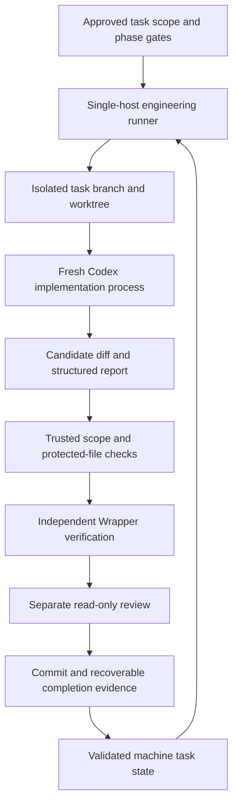

# Refined autonomous-development plan

Date: 2026-10-17. Status: **proposed; awaiting Phase 0 approval**.
Baseline: `1e1c4fe9411321804d4019d19467e6951c7ba63d`.
Read the [repository assessment](repository-assessment.md) for inspected source,
implemented boundaries, exact verification and limitations.

## Recommended adjustment

Bootstrap an engineering runner around the existing Java project and its tests.
Keep the product runtime and its local admission design intact. Do not rebuild
JWT validation, REST adaptation, catalog filtering, unit fixtures or CI. The
first implementation approval covers harness infrastructure and documentation
alignment only. A real gateway task and batch execution remain separate gates.

The engineering runner controls development tasks; it is not the enterprise MCP
product control plane. Product policy distribution, federation and clustered
execution remain governed by [ADR 0007](../decisions/0007-enterprise-platform-direction.md),
[ADR 0008](../decisions/0008-uc01-admission-first.md),
[ADR 0009](../decisions/0009-uc01-local-admission-design.md) and future explicit decisions.

Confirmed requirements come from [AGENTS.md](../../AGENTS.md),
[foundation specification](../FUNCTIONAL_SPEC.md),
[identity v1.4](../requirements/Enterprise_MCP_Identity_Authorization_Requirements_v1.4.md)
and [catalog v1.3](../requirements/Enterprise_MCP_Discovery_Catalog_Requirements_v1.3.md).
This proposed harness does not revise them or advance their acceptance rows.

## Architecture and trust boundaries



The controlling runner and validation policy execute from an approved immutable
revision outside the task agent's writable worktree. The agent can change only
the assigned task's candidate files. Reports, tool output and repository text
are evidence inputs, not permission to change the runner's policy. Enforce scope
again against the final Git diff; prompts alone are not access controls.

Reject changes to requirements, approval state, harness/verification policy,
CI, build configuration or dependency versions unless that task explicitly
authorizes them. Review code and test changes for weakened assertions or skipped
checks. Verify from a trusted command allowlist, without `shell=True` or a command
string supplied by the task agent. A runner executes project build code, so source
is still executable input: stronger host/network isolation is required before
admitting untrusted contributors or third-party code.

Use separate read-only review only after approval permits fresh runner sessions.
Do not spawn extra agents during Phase 0. The actual implementation agent never
decides that its own work is verified or sets `completed`.

## Lean file plan: reconcile every supplied path

All additions below are proposals for Phase 1 unless marked existing/Phase 0.
Status describes the artifact as assessed, not approval to create it now.

| Handover path | Current status | Repository-specific disposition |
| --- | --- | --- |
| `AGENTS.md` | VERIFIED_IMPLEMENTED | Reuse. Add a short runner boundary/read-order link only if needed; preserve standing no-delete and commit/push rules. |
| `README.md` | VERIFIED_IMPLEMENTED | Reuse. Add a short harness usage link after implementation verification. |
| `docs/handover/repository-assessment.md` | VERIFIED_IMPLEMENTED (Phase 0 document) | Current assessment and verification record; no second current-state inventory. |
| `docs/handover/refined-autonomous-development-plan.md` | VERIFIED_IMPLEMENTED (Phase 0 document) | This proposed plan; not an implemented harness. |
| `docs/handover/project-context.md` | NOT_IMPLEMENTED | Omit duplicate; reuse `docs/HANDOVER_UC01.md`, enterprise vision and WORKLOG current state. |
| `docs/requirements/platform-requirements.md` | PARTIALLY_IMPLEMENTED (equivalents) | Reuse functional spec, enterprise vision and stage plans. No new competing umbrella requirements. |
| `docs/requirements/identity-authorization.md` | VERIFIED_IMPLEMENTED (equivalent requirements document) | Reuse preserved identity v1.4. Documenting requirements is not implementation acceptance. |
| `docs/requirements/acceptance-criteria.md` | VERIFIED_IMPLEMENTED (equivalent trackers) | Reuse `docs/ACCEPTANCE.md`, `docs/IDENTITY_ACCEPTANCE.md`, `docs/CATALOG_ACCEPTANCE.md`; preserve distinct IDs. |
| `docs/architecture/current-state.md` | VERIFIED_IMPLEMENTED (equivalents) | Reuse this assessment, UC-01 guide and latest WORKLOG. Omit duplicate. |
| `docs/architecture/target-state.md` | VERIFIED_IMPLEMENTED (equivalent strategic document) | Reuse `docs/ENTERPRISE_MCP_VISION.md`; strategic acceptance does not authorize vendors or implementation. |
| `docs/architecture/decisions/` | VERIFIED_IMPLEMENTED (equivalent directory) | Keep `docs/decisions/`. Add one proposed/accepted harness ADR there after the appropriate decision. |
| `tasks/backlog.yaml` | NOT_IMPLEMENTED | Prefer `tasks/backlog.json` plus `tasks/schema.json`: Python stdlib JSON avoids adding a YAML parser. Same task semantics; format is proposed. |
| `tasks/progress.md`, `tasks/blockers.md` | PARTIALLY_IMPLEMENTED (human equivalents) | Reuse WORKLOG for narrative handoff; derive status/blockers from machine state. Omit independently editable duplicates. |
| `harness/orchestrator.py` | NOT_IMPLEMENTED | Add small stdlib CLI: modes, scheduler, process supervision, locking, evidence and recovery. |
| `harness/validator.py` | NOT_IMPLEMENTED | Add independent scope/report/test validation; execute trusted verification entry point. |
| `harness/config.yaml` | NOT_IMPLEMENTED | Prefer `harness/config.toml` using installed Python 3.13 `tomllib`; no credentials. Explicit commands, limits and model roles. |
| `harness/prompts/implement.md`, `review.md` | PARTIALLY_IMPLEMENTED (manual equivalents) | Existing `docs/AI_WORKFLOW.md` and `.agents/skills` supply workflow. Add only thin runner templates referencing them and scoped requirements. |
| `scripts/verify.sh` | PARTIALLY_IMPLEMENTED (Wrapper/CI equivalents) | Add thin POSIX wrapper and `scripts/verify.ps1`; both call Wrapper verify and use a unique run directory. Preserve CI's current behavior. |
| Harness tests (missing in generic file list) | NOT_IMPLEMENTED | Add `harness/tests/` using `unittest`, fake Codex/Git/verifier processes and controlled fixtures. No paid/model runs in unit tests. |
| Runtime state/logs (missing in generic file list) | NOT_IMPLEMENTED | Use ignored `target/harness/<run-id>/`; lock in shared Git common-directory state; logs/evidence must not contain secrets. Durable authoritative status remains in tracked task state plus commits. |

Do not create the omitted files just to satisfy the generic tree. Keep one
machine authority for task state; existing milestone plans remain human scope
and acceptance summaries, not a second queue. Generated status output is never
hand-edited. Protected requirements keep their original content and identifiers.

## Proposed task schema and readiness

Retain the supplied fields `id`, `title`, `status`, `priority`, `risk`,
`dependencies`, `spec_refs`, `scope`, `acceptance_criteria`, `tests`,
`requires_human_approval`, `review_required`. Add schema version; approved-scope
reference and hash; base commit; allowed paths; protected-path exceptions;
verification command IDs; model role; attempt/repair counts; run ID;
implementation/review/verification evidence references; content commit SHA;
block reason and approved runtime limits. Store no arbitrary executable commands
or secrets in task records.

Reject duplicate IDs, unknown states/fields, dependency cycles, missing references,
path traversal, scopes outside the worktree, unresolved approvals and mismatched
scope hashes. `requires_human_approval: false` alone is not evidence of approval.
A task is eligible only when explicitly `ready`, its approved scope matches the
current record, dependencies are durably completed and no relevant decision is open.

Use `pending -> ready -> in_progress -> validating -> completed`, with
`blocked`/`needs_review` terminal-for-this-run branches. Repair returns to
`in_progress` with a persisted counter. Cancellation/interruption records an
explicit reason; it never silently changes work to completed or automatically
reruns an uncertain external action.

## Ordered Phase 1 tasks and acceptance gates

These are the first **12 proposed tasks**, not a ready or executable backlog.
P1-01 through P1-11 are harness/bootstrap scope after Phase 0 approval.
P2-01 is the separately approved real pilot.

| ID | Scope | Dependencies | Observable completion gate |
| --- | --- | --- | --- |
| P1-01 | Record approved harness scope, ownership and defaults in existing ADR/agent docs; fix identified present-tense navigation drift | Phase 0 approval | Requirements bytes preserved; no acceptance promotion; read order and phase boundaries agree. |
| P1-02 | Schema and repository-specific backlog loader | P1-01 | Valid JSON accepted; duplicates, unknown fields, cycles, bad refs and unapproved/mutated scope rejected. |
| P1-03 | Cross-platform independent verify entry points | P1-01 | Exit propagation, unique report directory, current test inclusion and no clean/skip-tests proven; actual Windows Wrapper verify passes. POSIX execution remains unverified until run on a POSIX host/CI. |
| P1-04 | Bootstrap, status and dry-run | P1-02, P1-03 | Dry-run selects only eligible task and displays base, files, context, commands, limits and intended Git effects without feature edits or model calls. |
| P1-05 | Exclusive run ownership and worktree preflight | P1-04 | Competing runners, dirty/index/untracked state, symlink escapes and stale ownership fail safely; unrelated changes remain intact. |
| P1-06 | Supported fresh Codex process adapter | P1-05 | Fake process proves argv/stdin/JSONL/schema handling and secret-safe logs; real CLI help/model/sandbox preflight recorded; no resume/fork by default. |
| P1-07 | Independent candidate validator | P1-03, P1-06 | Reject agent-only success, protected-file drift, missing/stale reports, failed/skipped required tests and forged completion. |
| P1-08 | Independent read-only review and repair budget | P1-07 | High/critical/unresolved material findings prevent completion; no more than three repairs after initial attempt; budget persists across restart. |
| P1-09 | Cancellation, timeouts, interruption and commit reconciliation | P1-05, P1-08 | Windows process-tree termination tested; lock release; crashes before/after commit/status writes resume without duplicate implementation or reset. |
| P1-10 | Mocked single-task lifecycle and disabled batch | P1-09 | Positive lifecycle and all stop/failure paths pass using fakes; independent tasks do not continue after infra/security failures; batch refuses absent approval. |
| P1-11 | Usage, evidence and readiness report | P1-10 | Exact supported commands, run/status/log inspection, no-delete cleanup policy and distinct dry-run/single-task/batch verdicts documented; full relevant checks pass. Stop for Phase 1 review. |
| P2-01 | Ordinary catalog membership activation protocol regression test | Phase 1 acceptance and explicit pilot approval | Real Boot/SDK evidence described below; independent verify/review plus durable commit evidence. No runtime contract expansion. |

Each task must remain small enough for independent verification; split a task
before making it ready if its paths, acceptance cases or decision dependencies
expand. The initial schema/bootstrap work is directly implemented under approved
Phase 1 scope; it cannot depend on an unbuilt runner proving itself.

## Modes, limits and process execution

- **bootstrap:** initialize missing authorized control files; validate existing
  files and refuse overwrites of unrelated state. No gateway edits/model calls.
- **dry-run:** read-only eligibility/preflight report; no feature changes, commits,
  task claims or Codex sessions.
- **single-task:** one explicitly approved task through implementation, independent
  validation and required review. Default mandatory review for the first pilot.
- **batch:** disabled in Phase 1; later explicit approval allows 3–5 ready tasks
  sequentially. A task-count limit does not substitute for a runtime limit.

Proposed configurable starting bounds: one task, 60-minute total run, 20-minute
implementation/repair process, 15-minute verification, 10-minute review, at most
three repairs after the initial attempt. All subprocess deadlines are capped by
remaining total time. Emit progress/heartbeat promptly; stop on cancellation,
no eligible work, exceeded budget, approval gate, invalid state, verification
infrastructure failure, model unavailability or unsafe Git changes. Do not retry
infrastructure failures as if they were source-code failures.

Installed CLI help supports this illustrative argv shape (not executed in Phase 0):

```text
codex exec --cd <task-worktree> --sandbox workspace-write --model gpt-6-astra
  -c model_reasoning_effort="high" --json --output-schema <trusted-schema>
  --output-last-message <private-run-report> -
```

Pass argv as an argument list, not a shell string; feed the prompt through stdin.
On Windows resolve the actual executable or a controlled `.cmd` launch and test
quoting, spaces and process-tree supervision. CLI flags are help-verified only;
the exact safe headless approval behavior remains a Phase 1 preflight gate.
If permission is denied or approval cannot be delivered safely, stop and record
blocked state. Never add bypass/full-access flags to make unattended work proceed.

Proposed model policy: `gpt-6.1-sol`/medium for routine implementation,
`gpt-6-astra`/high for complex implementation and independent review. Both exact
IDs and reasoning levels appeared in the installed cache; availability must be
rechecked before launch. No silent fallback to a different model or effort.
Do not select a setting that implicitly delegates extra agents. Reasoning effort
is not an acceptance gate; independent evidence is.

Use an allowlisted minimal environment with private credential handling; omit
unnecessary deployment/provider secrets. Keep Warp integrations disabled and
preflight hooks/plugins so fresh sessions cannot revive the known Windows focus
problem. Never change file associations or remove editors. Do not install global
tools or edit user-wide model/security configuration as a runner side effect.

Record observable usage metadata if available, but do not advertise a hard spend
or token limit without a reliable runtime accounting/enforcement mechanism. Runtime,
task and repair caps are enforceable independently. A quota/auth failure stops the run.

## Git ownership and crash-safe completion

Use a dedicated task branch/worktree created from a recorded approved commit.
Refuse unsafe dirty primary/candidate state; leave all unrelated work untouched.
Serialize shared backlog writes across worktrees with an OS-held lock in the
Git common directory. Store owner/run/base metadata; a PID alone is insufficient
to reclaim stale ownership. Keep the lock file and release its handle rather than
deleting it. Do not automatically remove worktrees, branches, files or logs.

A passing verifier result is bound to the candidate tree hash and trusted verifier
revision; review must cover the same tree. Reject any subsequent unexplained change.
Commit only allowed task files after those gates. Do not use `git add .`, reset,
force-push or a successful process exit as evidence of task completion.

Git and task-state persistence are separate transactions. Proposed recovery:

1. Persist an attempt intent with run/task IDs, base SHA, approved scope and expected
   candidate tree; preserve failure evidence before starting another attempt.
2. Validate and review the exact candidate; persist evidence hashes and a prepared
   completion record before committing task content with a unique run marker.
3. Record the resulting content commit SHA in machine state using atomic file
   replacement, then a separate metadata commit. Do not try to embed a commit's own
   SHA inside that same commit.
4. On restart, reconcile intent, tree, commit marker and evidence. A completed
   content commit with missing metadata is finalized only after its original gates
   are verified; never run the implementation again just because status is stale.
   Divergence or ambiguous state becomes `needs_review`.
5. Publish approved task-branch commits to origin under standing repository
   authorization after gates. Never auto-merge into main. Record push failure as
   publication pending; it must not trigger duplicate implementation or force-push.

Any proposed cleanup/deletion requires the owner's explicit permission. Test
fixture cleanup rules must also respect that constraint; do not introduce a
destructive worktree/log janitor as part of bootstrap.

## Verification strategy and adversarial cases

Reuse real Java checks: full Wrapper verify includes unit/startup plus all five
IT classes; retain independent HTTP issuer/business fixtures and random ports.
Run targeted checks during repair, then full verify before accepting Java/config
changes. Collect exit code, current-run report counts, failures/errors/skips,
command, duration, base/candidate hash and environment versions. Reject missing
required suites or stale report reuse. Do not hardcode 162 as the forever test
count: prevent unexplained loss of required test classes and assertion coverage.

Harness tests use fake subprocesses and temporary/isolated paths. Required cases:
duplicate IDs/cycles; non-ready and approval-blocked tasks; dependency failure;
two runners claiming one task; dirty worktree; unauthorized paths or symlink escape;
model failure/malformed events; agent claiming success without tests; stale/forged
reports; validator tampering; review findings; third repair exhaustion; cancellation
with descendants; timeout; lock-holder exit; crashes at every persistence/commit
boundary; push failure; and attempted batch without its separate approval.

Secret canaries must be absent from reports/logs and task metadata. Do not upload
whole environment variables, JWTs, private provider replies or credential files.
Configure review to read only candidate diff and relevant source/spec/test evidence.
Changes to the harness itself require an independently trusted baseline verifier
and human review before the changed harness can become the trust root.

Do not introduce Testcontainers, a policy engine, OpenTelemetry or security scanners
solely because the generic handover lists them. Existing independent JDK HTTP
fixtures suit this pilot. Any later tool/dependency selection needs a concrete
gap, compatibility evidence and approval where required.

## First real pilot proposal

**P2-01: prove ordinary catalog membership activation through the current protocol.**
Reuse `src/test/java/dev/mcp/gateway/admission/Uc01AdmissionIT.java` and its fixtures.
The current `MEMBERSHIP` REQUEST branch activates eligible ordinary contracts;
CAT-E2E-01/AC-CAT-01 explicitly identify broader ordinary add/activate evidence
as unfinished. This pilot adds a test, not a new identity mode or business policy.

Approved test sequence should demonstrate:

1. An otherwise eligible delegated caller has no active membership: tools/list
   hides the tool and direct invocation causes zero business calls/protected output.
2. The correct catalog owner requests the pinned ordinary capability via existing
   `/control/changes`; membership becomes ACTIVE without granting unrelated authority.
3. The same existing SDK client observes the tool on its next tools/list and performs
   exactly one approved read using its exact downstream credential.
4. An unauthorized owner cannot activate membership; audit records preserve the
   actual actor, catalog/contract and before/after revision without credentials.

Use only independent issuer/business mocks and bounded waits. Allowed scope is
the named test, minimal fixture changes if necessary, and precise evidence updates
in the existing catalog tracker/WORKLOG. No production Java, dependency, credential
policy or endpoint change. If a runtime defect is revealed, preserve the failing
test and block for newly approved repair scope; do not silently broaden the pilot.
Promote only the tested acceptance subcase, not full AC-CAT-01 or the identity release.

Before executing this pilot, the owner reviews the Phase 1 harness and explicitly
selects P2-01. Afterward the owner reviews the cycle's selection, isolation,
validation, review and recovery evidence. Batch remains disabled until separately
approved; a successful pilot is not implied batch authorization.

## Product work after the pilot

Review remaining UC-01/U5 requirements first, then follow the selected UC-03
ordinary workload-read increment and UC-02 approval/provider requirements.
Do not replace that sequence with generic M1–M6 labels. Any audit coverage work
must specify trusted attribution before identity extraction; retention/archival
must define controlled expiry and its durability/security evidence before coding.
Keep full-release identity/catalog acceptance separate from harness readiness.

Native federation and registry publication follow a scoped product design:
deterministic public mappings, approved destinations, versioned snapshots, bounded
staleness/revocation and independently tested failure behavior. gRPC, telemetry,
quotas, cluster/session state and multi-region remain future slices. Provider,
policy engine, durable store, topology and protocol upgrades remain unresolved
technology choices; harness approval selects none of them.

## Approval and readiness record

Phase 0 approval should accept the bounded Phase 1 scope, lean file substitutions,
single machine task-state authority, trust boundary, model/default limits and
Windows-first verification approach. The concrete plan above is reviewable; no
implementation or batch permission is inferred from its existence.

Current readiness: repository baseline available; harness **dry-run not ready**;
**single-task pilot not ready**; **batch disabled/not approved**. Phase 1 ends only
when P1-01–P1-11 have executed evidence and separate readiness verdicts, with any
unavailable host/sandbox/model behavior labeled unverified. Stop there for pilot
approval, and stop again after the pilot for bounded-batch approval.

Phase 1 has not started. The next action is the owner's approval of this refined
Phase 1 plan, as required by the supplied handover's first-run stop condition.
